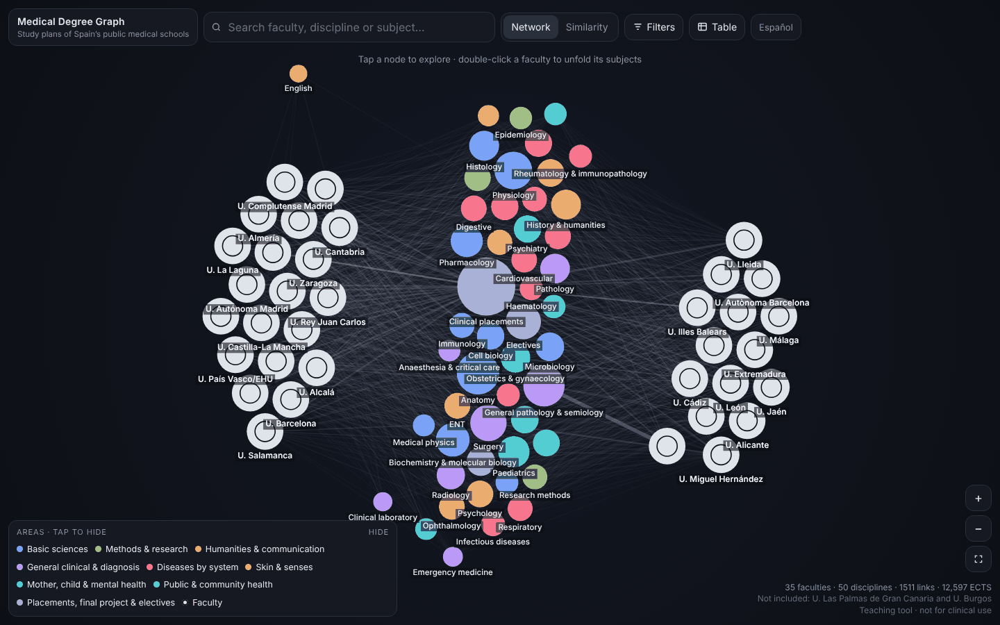

# Medical Degree Graph — Spain's public medical schools

An interactive, Obsidian-style graph of the **study plans of 35 public medical faculties in Spain**: every subject, its year, type and ECTS credits, linked to the disciplines it teaches.

**Live demo:** <https://ferasmed-dev.github.io/medical-curriculum-graph/> · [English](https://ferasmed-dev.github.io/medical-curriculum-graph/?lang=en)



## What it shows

- **Network view.** Each faculty is linked to around 50 disciplines (Anatomy, Paediatrics, Surgery…). Line width = ECTS that faculty gives the discipline. Disciplines are coloured by area (basic sciences, diseases by system, mother/child and mental health…); any area can be hidden from the legend.
- **Similarity view.** Faculties only, each linked to the three plans that resemble it most. Plans that weigh the same disciplines above or below the national average cluster together.
- **Details on tap.** A faculty shows credits by type, ECTS per discipline, its five most similar plans, the full plan year by year and a link to the official source. A discipline shows ECTS by faculty, which faculties have no subject identified for it, and the subjects included. *Unfold subjects* turns every subject of a faculty into its own node.
- **Search across subject names** (accent-insensitive): `genét` lights up 39 subjects at 34 faculties and compares their credits.
- **Filters** by year (1–6) and subject type (FB basic training, OB compulsory, OP elective, PE placements, TFG final project), faculty colour by region, physics sliders.
- **Data table** with every faculty and discipline, sortable, as a keyboard- and screen-reader-friendly view of the graph.
- Spanish / English, light / dark, desktop and phone (drag, pinch, pan).

## Curriculum fit

For **students and teachers at any Spanish medical faculty**, and for anyone comparing plans (faculty boards, curriculum committees, students considering a transfer).

Every *Grado en Medicina* follows **Orden ECI/332/2008**: 360 ECTS in six years and five common modules with minimum credits — morphology, structure and function of the human body (64); social medicine, communication skills and introduction to research (30); clinical training (100); diagnostic and therapeutic procedures (40); and supervised placements plus final project (60). Faculties differ in how they group, name and order subjects. The graph makes those differences visible over the shared core.

## For teachers

Every view is a link. Projected in class or sent to students:

| Link | Opens |
| --- | --- |
| [`?focus=anatomy`](https://ferasmed-dev.github.io/medical-curriculum-graph/?focus=anatomy) | Anatomy: ECTS at every faculty |
| [`?focus=paediatrics`](https://ferasmed-dev.github.io/medical-curriculum-graph/?focus=paediatrics) | Paediatrics across faculties |
| [`?focus=uv&expand=uv`](https://ferasmed-dev.github.io/medical-curriculum-graph/?focus=uv&expand=uv) | One faculty with all its subjects unfolded |
| [`?view=similarity`](https://ferasmed-dev.github.io/medical-curriculum-graph/?view=similarity) | Clusters of similar plans |
| [`?years=1-3&types=FB,OB`](https://ferasmed-dev.github.io/medical-curriculum-graph/?years=1-3&types=FB,OB) | Pre-clinical core only |
| [`?q=genet`](https://ferasmed-dev.github.io/medical-curriculum-graph/?q=genet) | Every subject with “genét…” in its name |

Parameters combine freely and with `&lang=en`. `focus` takes a faculty key (`data/universities.csv`, e.g. `ucm`, `ub`, `us`) or a discipline key (e.g. `cardiovascular`, `public-health`, `placements`). The **Filters → Copy link** button copies the current view.

## How the numbers are built

1. **Source tables** (`data/`): `universities.csv` (35 faculties, official source link and notes) and `subjects.csv` (1,942 rows: faculty, year, semester, subject, type, ECTS), compiled from each faculty's plan as published in the BOE/regional bulletins, verification reports or official websites (2025-27).
2. **Disciplines.** `scripts/build_data.py` tags each subject with one or more of 50 disciplines by matching its name (Spanish and Catalan) against hand-written rules. A subject matching several disciplines (e.g. *Medicina y Cirugía del Aparato Respiratorio* → Respiratory + Surgery) splits its ECTS equally between them. Placements, final projects and electives get their own nodes. Basic sciences of a system (*Neuroanatomía*) stay basic sciences, not clinical neurology.
3. **Filters.** A row spread over several years (e.g. a 16-ECTS final project in years 4–6) counts in proportion to the selected years.
4. **Similarity.** Each plan is a vector of ECTS per discipline. The national mean vector is subtracted and the cosine of the deviations is shown as an affinity from −100 to 100. Without centring, the blocks every plan shares (54 ECTS of placements, 6 of TFG…) make every pair look ~97 % alike.
5. **Layout.** Force-directed: pairwise repulsion, springs whose rest length shortens and stiffness grows with ECTS, central gravity and collision (`src/physics.js`).

| Parameter | Value | Basis |
| --- | --- | --- |
| Total per plan | 360 ECTS | Orden ECI/332/2008 (checked in tests; Almería's source lists 357) |
| Similarity neighbours | 3 per faculty | **Model**: readability |
| Repulsion / link distance / strength / gravity | 1100 / 110 / 0.35 / 0.25 | **Model**: layout tuning, adjustable in Filters |
| Node size | faculty ∝ √ECTS in filter; discipline ∝ √total ECTS | **Model** |

## Known limitations

- **Name-based classification.** Integrated or problem-based curricula (Girona, Pompeu Fabra, Jaume I, Lleida) name subjects by module, so some disciplines are under- or over-counted there (e.g. Anatomy at Jaume I appears as 3 ECTS because anatomy is taught inside organ-system modules). Per-discipline figures are approximate; per-type and total figures are exact to the source.
- **Missing faculties.** Universidad de Las Palmas de Gran Canaria (its plan page could not be retrieved) and Universidad de Burgos (degree started in 2026-27, plan not yet published).
- **Coarse sources.** Miguel Hernández and Pública de Navarra publish only multi-year subject groups (*materias*); Almería's year 3 adds up to 57 ECTS in its source; some plans have no semesters. Every caveat is in `data/universities.csv` and shown on the faculty's card.
- Electives are counted as credit blocks, not individual options.
- Plans change: check the linked source before using a figure for transfers or credit recognition.

## Layout

```
index.html
src/model.js      pure functions: filters, aggregation, similarity, graph building, search, deep links
src/physics.js    force-directed layout step (pure)
src/i18n.js       Spanish and English strings
src/ui.js         canvas rendering, interaction, panels, data table, language, links
src/styles.css
data/universities.csv, data/subjects.csv   source tables
data/graph-data.json                        built by scripts/build_data.py
scripts/build_data.py
tests/model.test.js
curriculum.json   topic metadata
```

No build step, no dependencies, no CDN.

## Run locally

```bash
python3 -m http.server 8000
# open http://localhost:8000
```

(Opening `index.html` directly from disk does not work because the data is loaded with `fetch`.)

To change the data, edit the CSVs and rebuild:

```bash
python3 scripts/build_data.py
```

## Tests

```bash
npm test      # node --test, Node 18+
```

26 tests: data integrity (360 ECTS per plan, every subject classified, types valid), aggregation identities, year filters partitioning totals, similarity properties, graph building, physics stability, search, deep-link round trips, and matching Spanish/English string sets. They run on every push via GitHub Actions.

## Deploy

Settings → Pages → *Deploy from a branch* → `main` / `(root)`. The site appears at `https://ferasmed-dev.github.io/medical-curriculum-graph/` after a minute or two.

## References

- Orden ECI/332/2008, de 13 de febrero (BOE núm. 40, 15/02/2008): requisitos para la verificación de los títulos que habiliten para el ejercicio de la profesión de Médico.
- Real Decreto 854/2026 (BOE-A-2026-21954), Anexo I: plazas de Medicina en universidades públicas.
- Each faculty's plan: link in `data/universities.csv` and on its card in the app.

## Licence

MIT © 2026 Feras Elhissi. Teaching tool · not for clinical use.
